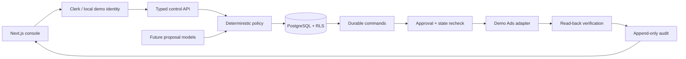

# Architecture decisions · v0.1

## ADR-001: Internal-first with tenant boundaries

The first release is an internal operator tool with tenant IDs, server RBAC, PostgreSQL RLS, scoped foreign keys and Clerk integration. Demo identity is explicitly gated by APP_MODE and loopback startup. Live mode never falls back to demo identity. Clerk org mappings are server-managed; org IDs are not tenant UUIDs.

## ADR-002: PostgreSQL queue

Queue transactions use `FOR UPDATE SKIP LOCKED`, a resource advisory transaction lock, an account-control row lock, and independent preflight checks. Lease timestamps record attempt windows; transaction locks serialize execution. Process failure rolls back the lease and local effects. Commands persist across worker restarts. Prior ambiguous attempts are read back before replay; retryable failures use capped exponential backoff and quarantine after three attempts.

External Ads writes cannot be rolled back by PostgreSQL. A future live adapter must recover from remote success followed by local crash: preserve command identity and read back before retry. Database transactions alone do not guarantee exactly-once external mutation.

## ADR-003: Human-approved demo execution

Only campaign pauses and bounded budget reductions are executable. Every command requires approval. Budget increases, auto-resume, emergency pause automation, bids, negative publication and creative publication are disabled. The demo adapter never calls Google. Live activation requires separately reviewed implementation and controlled-account validation.

## ADR-004: Evidence and financial precision

Strict proposals contain immutable sources, attribution maturity, sample size, policy version, expiry, before/after fields and idempotency keys. Policy checks reject fabricated metrics, foreign sources, stale/incomplete data and invalid masks. Financial calculation uses bigint/string micros and TypeScript BigInt. Number conversion is limited to display and numeric proposal contracts.

Demo pacing extrapolates a known synthetic 60%-elapsed day with an illustrative 0.8–1.25 envelope. This is not calibrated forecasting. Live pacing must handle account timezones, DST, schedules and reporting delay; until implemented it returns unknown. Missing spend never becomes zero. Forecast risk does not grant emergency authority.

## Retention and classification

Demo data has no PII or click identifiers. Outcome APIs accept external IDs rather than names/contact details. Production requires consent rules, encryption, subprocessors, warehouse correction timestamps and retention decisions. Proposed values for review: reporting snapshots 13 months, attempts 90 days, financial outcomes/audit according to legal requirements. These are proposals, not implemented deletion schedules. Immutable record deletion needs a privileged audited maintenance path; never grant it to the app role.

Indexes cover latest snapshots, queue eligibility, audit timelines, tenant idempotency and account identity. Measure query plans and storage before warehouse scale.
