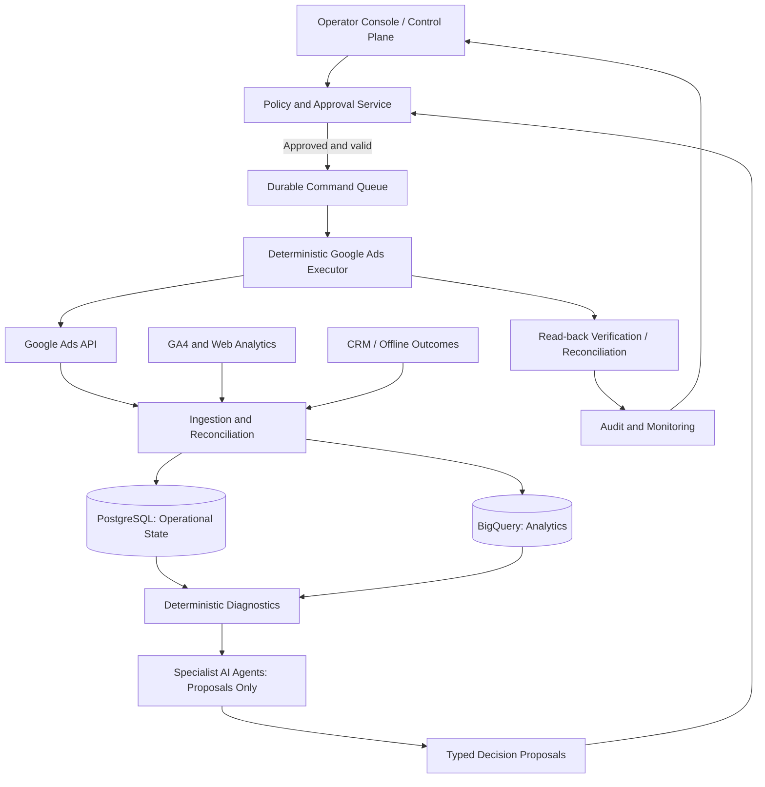
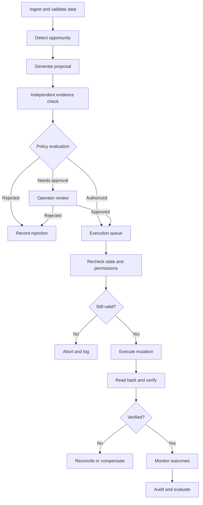

# Autonomous Google Ads Operating System

**Ultimate Technical Architecture & Engineering Specification**  
**Version:** 2.0 Draft  
**Status:** Proposed architecture; requires product scope and API-version validation  
**Date:** October 14, 2026

## 1. Executive Summary

Build a production-grade, measurable, auditable advertising optimization system that uses language models for analysis and proposal generation, while deterministic services control permissions, budgets, execution, and verification. The platform should be capable of internal deployment and designed for eventual multi-tenant SaaS use.

**Non-negotiable principle:** AI agents never receive unrestricted direct mutation access to advertising accounts.

### Goals

- Optimize for business outcomes (qualified leads, completed sales or move-ins, realized revenue, contribution margin), not just clicks and platform conversions.
- Provide account-level visibility, decision traceability, and risk-aware optimization.
- Support observation, recommendations, human-approved execution, and narrowly bounded autonomy.
- Recover safely from delayed reporting, API outages, duplicate events, partial failures, and conflicting data.

### Non-goals

- Guaranteeing zero overspend: Google Ads cost reporting and pause execution are not instantaneous.
- Unsupervised unlimited bidding, budgeting, or creative publication.
- Treating LLM judgments as validated financial or statistical evidence.

## 2. Reference Architecture



### Separation of responsibilities

- **Control plane:** operators, RBAC, account policy, approvals, emergency controls, settings.
- **Data plane:** API ingestion, source snapshots, metric normalization, CRM event reconciliation.
- **Intelligence plane:** deterministic analyses, forecasting, experimentation, LLM drafting and explanation.
- **Policy plane:** risk budgets, allowlists, deny rules, authorization, change caps, freshness gates.
- **Execution plane:** durable commands, preflight checks, idempotency, API mutations, read-back verification.
- **Observability plane:** metrics, alerts, audit events, error budgets, evaluation and attribution.

Pipedream may orchestrate integrations and notifications, but must not be the authoritative state store, financial ledger, or sole executor.

## 3. Proposed Technology Stack

| Layer | Technology | Notes |
|---|---|---|
| Frontend | Next.js, TypeScript, Tailwind | Operator console and review workflows |
| Authentication | Clerk | Enforce tenant RBAC server-side |
| Services | Node.js / TypeScript | Typed APIs and deterministic control |
| Operational database | PostgreSQL | Transactional source of truth |
| Workflow execution | Temporal or durable PostgreSQL-backed queues | Retries, leases, scheduled jobs |
| Analytics | BigQuery | Historical fact tables and modeling |
| Integration automation | Pipedream (optional) | Non-critical integration adapters |
| AI | Claude / Gemini behind abstraction | Structured outputs, model version tracking |
| Telemetry | OpenTelemetry + alerting | Traces, logs, service health |
| Hosting | Vercel + Railway / managed containers | Separate web from workers |
| Secrets | Managed secret store | Least-privilege credentials and rotation |

All Google Ads API versions, resource fields, OAuth scopes, developer-token access requirements, quotas, and mutation semantics must be validated against the supported release at implementation time. Do not hard-code an unverified version.

## 4. Functional Subsystems

1. **Account Management:** MCC hierarchy, OAuth connection status, customer mappings, tenant isolation, roles.
2. **Data Ingestion:** Google Ads reporting, GA4, CRM, offline conversions, source timestamps.
3. **Data Quality:** freshness, deduplication, completeness, reconciliation, anomaly detection.
4. **Financial Control:** pacing, forecasted exposure, configurable spending limits, alerts and pause policies.
5. **Campaign Intelligence:** campaign and ad-group performance diagnosis, trend and anomaly analysis.
6. **Search Intent:** term classification, negative keyword proposals, protected-intent rules.
7. **Keyword Discovery:** search-query mining, expansion candidates, match-type recommendations.
8. **Bidding Intelligence:** target and strategy monitoring; conservative bid-change proposals.
9. **Creative Intelligence:** RSA drafts, character limits, policy review, asset testing.
10. **Landing Page Intelligence:** relevance, page health, conversion-path diagnostics.
11. **Audience Intelligence:** geographic, device, schedule, and segment comparisons.
12. **Attribution & Revenue:** lead quality, offline outcome capture, realized revenue and margin.
13. **Experimentation:** pre-registered hypotheses, controls, statistical evaluation.
14. **Forecasting:** spend, conversions, CPA and revenue with uncertainty bounds.
15. **Decision Engine:** prioritized, evidence-linked proposed actions.
16. **Policy Engine:** deterministic permissions, guardrails, approvals and vetoes.
17. **Execution Engine:** typed commands, bounded retries, verification and compensation.
18. **Agent Orchestration:** specialized agents with scoped tools and no direct Ads writes.
19. **Monitoring & Audit:** immutable decision/event trails, alerts, service health.
20. **Operator Dashboard:** approvals, overrides, decision explanations, performance reporting.

## 5. Autonomy and Permission Model

| Level | Authority | Example |
|---|---|---|
| L0 | Observe | Detect CPA anomaly |
| L1 | Recommend | Suggest negatives with evidence |
| L2 | Draft and approve | Prepare RSA for human approval |
| L3 | Bounded execution | Apply eligible low-risk approved policy changes |
| L4 | Conditional autonomy | Execute tested changes within explicit limits |
| Safety authority | Emergency protection only | Pause an eligible campaign on verified risk trigger |

Emergency protection is **not** a higher general-purpose agent privilege. It has a narrowly scoped action set and separate policy.

### Agent roster

| Agent | Responsibility | Write access |
|---|---|---|
| Scout | Find opportunities | None |
| Analyst | Diagnose anomalies | None |
| Strategist | Rank proposals | None |
| Creative | Draft copy and assets | Draft storage only |
| Experimenter | Design and assess tests | Draft storage only |
| Guardian | Independently enforce policy | Veto/block only |
| Executor | Perform authorized commands | Strictly scoped Google Ads mutations |
| Auditor | Verify state and outcomes | None |

The Executor is deterministic software, **not** an LLM. The policy engine must independently check all agent outputs.

## 6. Financial Risk and Pacing

### Constraints

- Google Ads cost reporting can be delayed; polling does not provide a guaranteed hard spending cap.
- Daily budgets and platform billing behavior may permit spend above an average daily budget on individual days.
- Pausing a campaign does not retroactively undo spend and may not be instantaneous.
- Use platform-supported budget controls alongside independent forecasts and alerting.

### Initial example policies (not universal defaults)

| Setting | Proposed initial value |
|---|---|
| Account daily planned spend | $250 |
| Pacing warning | 80% of risk-adjusted forecast threshold |
| Autonomous budget increases | Disabled (0%) |
| Max eligible autonomous budget reduction | 10% |
| Performance-decision data freshness tolerance | 3 hours |
| Budget increase approval | Always human-approved |

All limits are tenant/account-configurable. Missing data must not be interpreted as zero spend. Stale data suspends performance optimization but must not disable independent safety responses.

### Pacing controller

1. Ingest cost with observed-at and source freshness timestamps.
2. Compute account and campaign aggregates in the account's timezone and currency.
3. Reconcile budget resource configuration and scheduled changes.
4. Forecast remaining spend with uncertainty and conservative safety margins.
5. Classify status: healthy, warning, elevated risk, or emergency.
6. Require an independently validated trigger before issuing a pause command.
7. Verify read-back state, alert operator, and record residual exposure uncertainty.
8. Never automatically resume a paused campaign without a separate authorization policy.

## 7. Decision Proposal Contract

```typescript
type DecisionProposal = {
  id: string;
  tenantId: string;
  customerId: string;
  resourceName: string;
  action:
    | "PAUSE_CAMPAIGN"
    | "UPDATE_BUDGET"
    | "PROPOSE_NEGATIVE"
    | "UPDATE_BID_TARGET"
    | "CREATE_AD_DRAFT";
  observedAt: string;
  evidenceWindow: { start: string; end: string };
  evidence: Array<{
    metric: string;
    value: number;
    sampleSize: number;
    sourceSnapshotId: string;
    attributionMature: boolean;
  }>;
  expectedImpact: {
    metric: string;
    estimate: number;
    lowerBound: number;
    upperBound: number;
  };
  mutation: {
    before: Record<string, unknown>;
    after: Record<string, unknown>;
  };
  policyVersion: string;
  modelVersion: string | null;
  expiresAt: string;
  idempotencyKey: string;
};
```

A proposal is never itself permission to execute. Require schema validation, freshness checks, policy evaluation, approvals as appropriate, resource-state comparison, and an execution lease.

## 8. Mutation Lifecycle



### Execution requirements

- Stable command ID and idempotency key; reject or reconcile duplicates.
- Explicit resource target, mutation mask, before/after values, and expiration.
- Preflight account/tenant permissions, policy version, and expected current resource state.
- Serialize conflicting mutations per resource or enforce optimistic concurrency.
- Bound retries; on ambiguous network failure, read back before retrying.
- Persist API request IDs, response metadata, outcomes, and verification status.
- Define reversible operations and compensating actions; no false guarantee of complete rollback.
- Quarantine repeatedly failing commands and alert operators.

## 9. Operational Data Model

Core PostgreSQL entities:

`tenants`, `users`, `roles`, `ad_accounts`, `account_policies`, `campaign_snapshots`, `metric_observations`, `conversion_events`, `crm_outcomes`, `decision_proposals`, `evidence_records`, `approval_events`, `mutation_commands`, `mutation_attempts`, `verification_results`, `experiments`, `alerts`, `audit_events`.

### Data design standards

- Tenant ID on every tenant-scoped entity; row-level authorization tests.
- Immutable source snapshots and append-only audit events where feasible.
- UTC timestamps plus account-local date/timezone for Ads reporting.
- Currency code and micros precision for financial values; avoid floating-point money arithmetic.
- Versioned policy documents and model/prompt identifiers.
- Retention, access classification, and deletion policies for personal data.
- Warehouse facts must distinguish event time, ingestion time, and attribution correction time.

## 10. Conversion Attribution and Revenue

For a senior living referral use case, track:

`impression → click → inquiry → qualified lead → tour → completed move-in → collected referral revenue → contribution margin`.

### Measurement requirements

- Capture consent-appropriate click identifiers and attribution metadata.
- Map CRM stages to stable, deduplicated conversion events.
- Distinguish provisional outcomes from finalized or paid outcomes.
- Reconcile canceled move-ins, refunded fees, duplicate leads, and delayed revenue.
- Record conversion upload status and errors; never assume API acceptance equals correct attribution.
- Report cost per qualified lead, cost per completed move-in, realized ROAS, and contribution margin.
- Use statistical safeguards for sparse, delayed outcomes.

## 11. AI Reasoning Standards

- LLMs can classify, summarize, draft, rank, and explain; they cannot bypass deterministic checks.
- Use structured outputs validated against strict schemas.
- Include source IDs, date windows, sample sizes, confidence bounds, and missing-data flags.
- Reject unsupported factual claims and invented campaign statistics.
- Protect against prompt injection in search terms, landing-page content, and external documents.
- Do not send unnecessary customer PII to external models.
- Log prompt/template versions, model versions, evaluation scores, and human overrides.
- For negative keywords, require relevance analysis, match-type review, protected-term checks, and approval policies; zero conversions alone is insufficient evidence.

## 12. Security and Compliance

- OAuth 2.0 credentials and Google Ads developer token stored in managed secrets.
- Include required developer-token and manager-login headers where applicable.
- Verify scopes, customer access, account ownership, and API eligibility.
- Apply least-privilege service identities and server-side RBAC.
- Encrypt sensitive data in transit and at rest.
- Audit access to customer and advertising data.
- Rate-limit APIs and honor quotas and retry guidance.
- Document consent, privacy, retention, and data-subprocessor practices.
- Ensure creative generation is checked against Google Ads editorial and advertising policies.

## 13. Reliability and Observability

### Key signals

- Ingestion freshness and completeness by account.
- API success/error and quota usage.
- Queue age, dead-letter count, and retry rate.
- Proposed versus approved versus executed changes.
- Mutation read-back verification latency and mismatch rate.
- Spend forecast error and safety-trigger activity.
- CRM-to-Ads conversion reconciliation rate.
- Agent schema failure, unsupported evidence, and human override rates.

### Required runbooks

- Google Ads API outage or quota exhaustion.
- Expired OAuth credential or revoked account access.
- Reporting delay or missing spend data.
- Duplicate workflow events and conflicting writes.
- Ambiguous mutation timeout.
- Unexpected spending spike.
- Incorrect negative keyword or creative publication.
- Cross-tenant access attempt.
- Conversion upload failure or CRM reconciliation discrepancy.

## 14. Testing and Release Gates

| Gate | Required evidence |
|---|---|
| Security | Tenant isolation, RBAC, secret-handling tests |
| Data | Freshness, completeness, reconciliation tests |
| Policy | Unauthorized and over-limit changes rejected |
| Execution | Duplicate and concurrent commands handled safely |
| Reliability | Ambiguous API outcomes reconciled; retry limits enforced |
| Audit | Every mutation traceable from evidence to verification |
| Financial | Overspend, stale-reporting, and pause-delay scenarios tested |
| Intelligence | Recommendation quality compared to documented baseline |
| Autonomy | Shadow-mode and controlled live tests passed |

Use fixtures and sandbox/test accounts where available; never rely solely on mocked success responses. Production rollout should be account-scoped, gradual, and reversible where technically possible.

## 15. Experimentation and Evaluation

Each strategy must have:

1. Frozen hypothesis, target population, action definition, and exclusion rules.
2. Historical replay with point-in-time data and leakage controls.
3. Baseline comparison and uncertainty estimates.
4. Prospective experiment with appropriate controls or holdouts.
5. Explicit handling of delayed conversions, seasonality, and learning periods.
6. Decision threshold, stop conditions, and post-deployment monitoring.

Do not promote a strategy merely because an LLM explanation sounds compelling or a retrospective chart looks positive.

## 16. Delivery Phases

### Phase 1 — Foundation

Deliver account connections, data contracts, PostgreSQL schema, ingestion, reconciliation, operator identity, and telemetry. **Exit:** trusted read-only performance view.

### Phase 2 — Safety and Execution

Deliver policy engine, approvals, command queue, mutation adapter, read-back verification, audit log, and kill switch. **Exit:** controlled manually approved mutations.

### Phase 3 — Intelligence

Deliver diagnostics, search intent, keyword and creative proposals, explainable ranking, and model evaluation. **Exit:** recommendations with measurable evidence quality.

### Phase 4 — Business Attribution

Deliver CRM integration, qualified lead and completed outcome tracking, offline conversion processing, revenue reconciliation, and margin reporting. **Exit:** business-outcome dashboards.

### Phase 5 — Controlled Autonomy

Deliver shadow-mode validation, prospective experiments, bounded policies, monitoring and gradual rollout. **Exit:** narrowly authorized automated changes with demonstrated safety and value.

## 17. Required Engineering Deliverables

- Versioned architecture diagrams and architecture decision records.
- SQL DDL, migrations, retention and indexing plan.
- OpenAPI contracts, event schemas, and typed command contracts.
- Google Ads adapter interface and API compatibility matrix.
- Agent prompts, structured schemas, permissions and evaluation harness.
- Policy DSL/configuration schema with example test cases.
- Workflow state machines, retry/reconciliation logic, and dead-letter procedures.
- Infrastructure-as-code and secrets management plan.
- Automated tests, fixtures, fault injection and load tests.
- Deployment, rollback/compensation, on-call and incident-response runbooks.
- Operator UI wireframes and acceptance criteria.
- Experiment design and production autonomy graduation criteria.

## 18. Open Architecture Decisions

1. Internal-only, multi-client SaaS, or internal-first/SaaS-ready product scope.
2. Temporal versus a durable PostgreSQL queue for workflow execution.
3. Exact supported Google Ads API version and account access tier.
4. CRM source of truth and definitions of qualified lead, completed outcome, and realized revenue.
5. Initial account budgets, risk thresholds, alert destinations, and authorized approvers.
6. Data retention, privacy requirements, and model-provider restrictions.
7. First production mutation types and their autonomy levels.
8. Success metrics, experiment duration, and statistical decision criteria.

---

**Specification status:** Architecture baseline, not yet a complete build-ready implementation package. Before coding, resolve the open decisions and produce the detailed schemas, service interfaces, tests, and deployment artifacts listed above.
